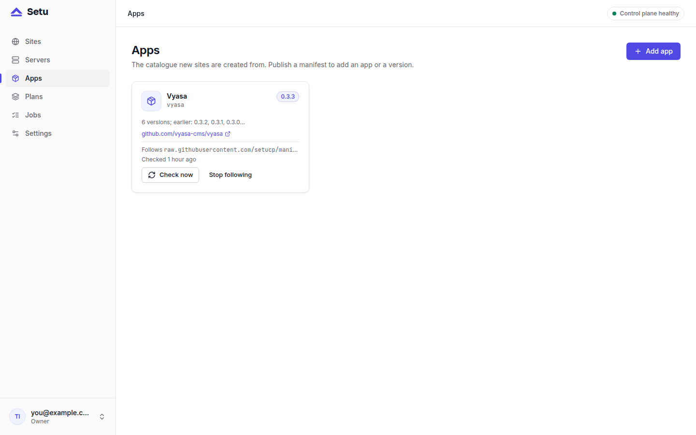
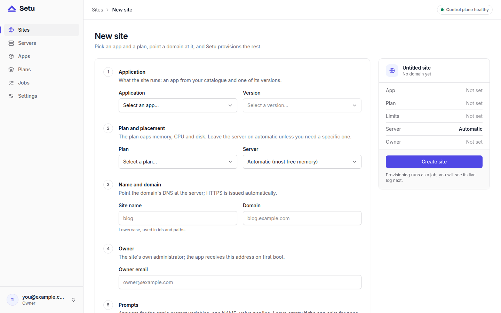
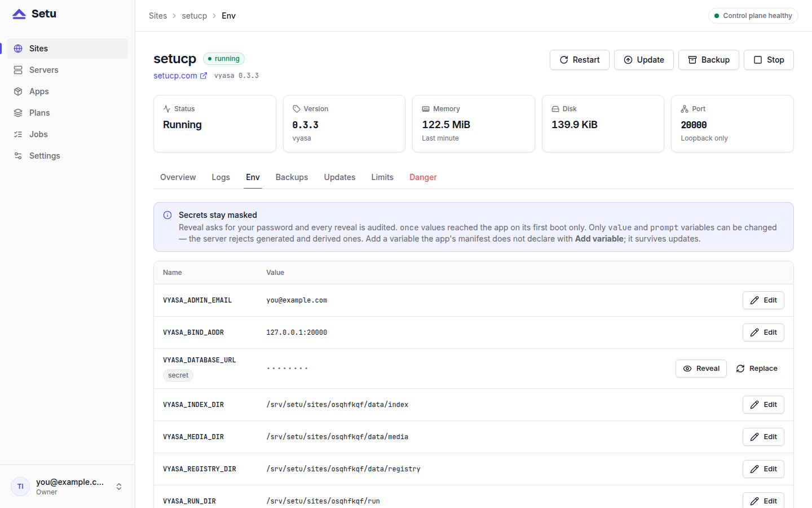
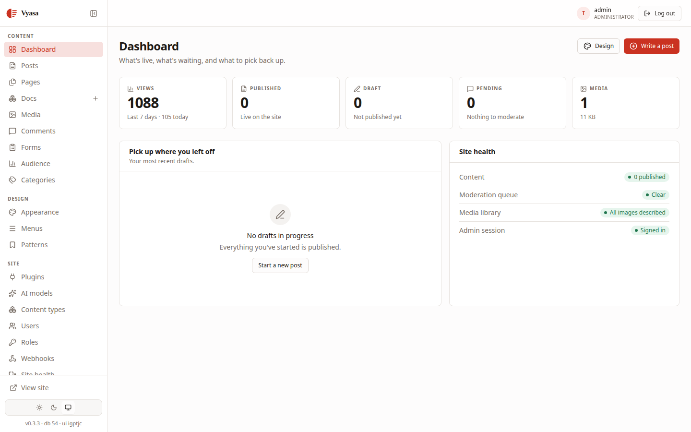
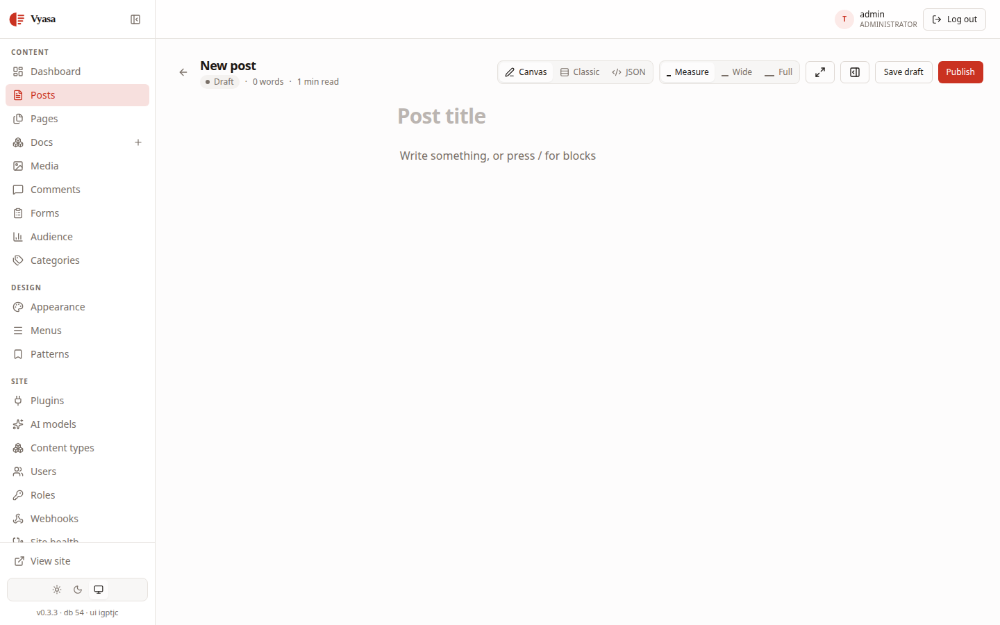

Once Setu is installed, the quickest way to see what it does is to deploy Vyasa CMS, the first app in its catalogue. Vyasa is a content management system written in Rust that needs only its server binary and PostgreSQL. This guide goes from an empty panel to signing in to Vyasa's admin, and explains what Setu set up along the way.

You need a running panel with one server online. If you do not have that yet, start with [install Setu in five minutes](post:install-setu-in-five-minutes).

## Step 1: point a domain at the server

Pick the domain for the site, for example `blog.example.com`, and create a DNS record pointing it at the server's public IP. Caddy gets the site's certificate through ACME, which only works once the name resolves to your server, so create the record before the site.

The site domain must be different from the panel host. Setu refuses a site domain equal to the panel host, `localhost` or a server's hostname.

## Step 2: add the Vyasa app

Apps come from manifests, one TOML file per version. Ready-made manifests live in the [setucp/manifests](https://github.com/setucp/manifests) repository, including one for Vyasa 0.3.3 with builds for x86_64 and aarch64.

In the panel, open **Apps → Add** and paste the manifest's raw URL:

```text
https://raw.githubusercontent.com/setucp/manifests/main/vyasa/manifest.toml
```

Setu validates the manifest and publishes the version. Because you added it from a URL, the app now follows that URL: Setu checks it every 6 hours and publishes new versions as they appear. Nothing is installed on a site until you choose to update. The Apps page shows the URL with **Check now** and **Stop following**.



## Step 3: what the manifest asks for

It helps to read the important parts of the manifest before creating a site:

```toml
[app]
id = "vyasa"
version = "0.3.3"
health = "/readyz"
admin_path = "/admin"
startup_grace_s = 90

[needs]
postgres = ">=16"
dirs = ["media", "index", "registry"]

[env]
VYASA_BIND_ADDR      = { from = "bind_addr" }
VYASA_DATABASE_URL   = { from = "postgres_url" }
VYASA_SECRET_KEY     = { generate = "hex32", secret = true }
VYASA_ADMIN_EMAIL    = { from = "owner_email" }
VYASA_ADMIN_PASSWORD = { generate = "password20", secret = true, once = true }

[limits.default]
memory_mb = 512
cpu_percent = 100
disk_mb = 5120

[backup]
postgres = true
dirs = ["media", "registry"]
```

That excerpt leaves out a few env lines and the `[run]` table. In plain words: Vyasa gets its own database, three persistent directories, a generated secret key, and a generated admin password that is used only on first boot. It binds to `127.0.0.1` on its own port, so only Caddy reaches it. Backups include the database, `media` and `registry`, but not `index`, which Vyasa can rebuild.

## Step 4: deploy Vyasa CMS as a new site

Open **New site**, choose Vyasa, enter the domain and the owner email. The owner email becomes `VYASA_ADMIN_EMAIL`, the first administrator's login.



Setu allocates the port, database and secrets in one step, then runs the provisioning job: create the site user and directories, create the database, install and verify the binary, write the systemd unit and env file, start the site, wait for `/readyz`, add the Caddy route and verify. You can follow it live on the Jobs page. When it finishes, the site is `running`, with a nightly backup scheduled.

If a step fails, the site is marked `failed` with the step that failed, and **Retry** re-runs provisioning with the same allocations and secrets.

## Step 5: reveal the admin password and sign in

The admin password was generated once, and Vyasa used it to create the administrator on first boot. After the first successful health check, Setu rewrites the env file without it, so it is never written again. The control plane keeps it sealed so you can still read it.

Open the site's **Env** tab. Secret values are masked. Reveal `VYASA_ADMIN_PASSWORD` by entering your own panel password; every reveal, and every denied attempt, goes into the audit log.



The site overview links to the admin page, built from the manifest's `admin_path`. Open `https://blog.example.com/admin` and sign in with the owner email and the revealed password.



## What to do in Vyasa first

Start with a first post. Vyasa stores content as structured blocks, and its editor is a writing canvas built on ProseMirror, with a classic field editor that reads and writes the same block document.



Plugins and themes come from the official marketplace under **Plugins → Browse plugins** and **Appearance → Browse themes**. Plugins run in a WebAssembly sandbox with only the capabilities they declare.

## Next steps

Your site already has a nightly backup; [how Setu backups work](post:how-setu-backups-work) explains what is in it and where it lives. When Vyasa releases a new version, it will appear in the site's Updates tab, and [safe app updates](post:safe-updates-backup-first) explains what happens when you click it. This blog itself is a Vyasa site run by the Setu panel at panel.setucp.com, on one VPS.
