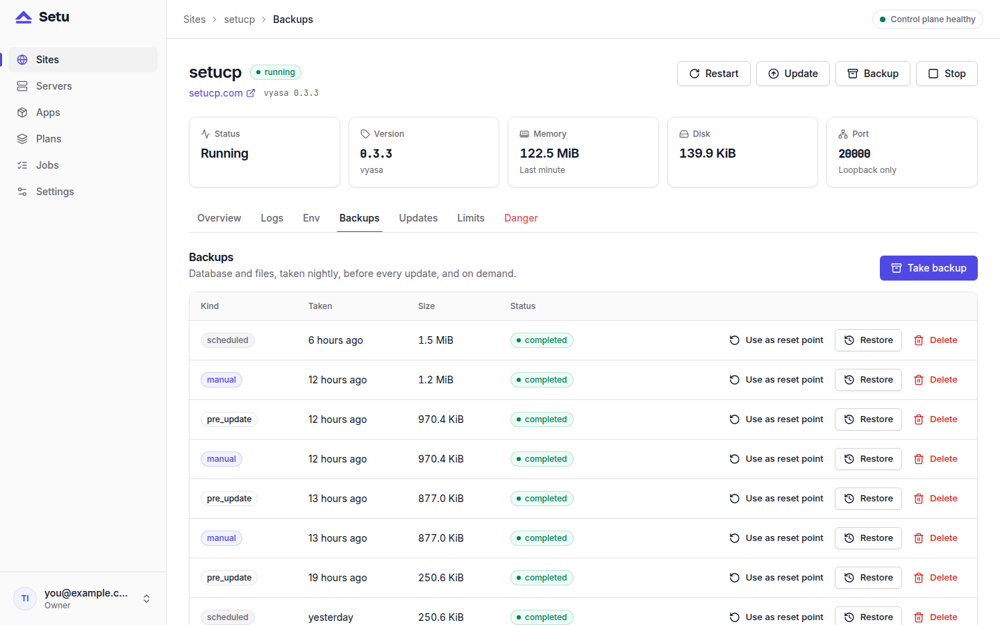

Setu backups are on by default: every running site gets a nightly copy of its database and its data directories, and every risky operation takes a copy first. That covers most mistakes, but not every disaster, because in this phase the backups stay on the server. This post explains exactly what Setu backs up, when, where the files are, and what you still need to do yourself.

## What a backup contains

A site backup is two files:

- `db.dump`, a `pg_dump -Fc` of the site's database, `site_<short>`;
- `dirs.tar.zst`, a zstd-compressed tar of the directories the app's manifest lists under `[backup] dirs`.

The manifest decides what is worth keeping. Vyasa's, for example:

```toml
[backup]
postgres = true
dirs = ["media", "registry"]
```

Vyasa also has an `index` directory, but it can be rebuilt, so the manifest leaves it out. The app's binary is not in the backup either: it is a published release, identified by URL and checksum in the manifest, and can be downloaded again.

The privileged helper streams the archive and never follows a link a site user planted in its data directory. Links and special files are skipped, and so are regular files the site user does not own or that have more than one hard link.

## Where backups live

Backups sit on the server that runs the site:

```text
/var/lib/setu/backups/<short>/<backup_id>/db.dump
/var/lib/setu/backups/<short>/<backup_id>/dirs.tar.zst
```

They are owned by `setu`, mode 0750. Two things to know: they are **not encrypted**, and they are **not copied off the box** in this phase. The dump holds the app's data and any secrets the app stored in its own database, so treat the directory accordingly.

## The five kinds of Setu backups

| Kind | Made by | Kept |
|---|---|---|
| `scheduled` | the nightly scheduler | newest 7 per site |
| `manual` | **Backups → Back up now** | until you delete it |
| `pre_update` | every update, before the new version is installed | 30 days |
| `pre_restore` | every restore, before it replaces anything | 30 days |
| `pre_delete` | every site delete | 30 days, outliving the site |



Manual backups are never deleted automatically. The safety copies, `pre_update`, `pre_restore` and `pre_delete`, are what make updates, restores and deletes reversible. A failing `pre_delete` backup stops the delete with the site untouched, unless the site had already failed.

## How the nightly schedule works

The control plane runs a scheduler that ticks every minute. Each night it enqueues one backup for every **running** site at 03:00 in the control plane's local time zone. Each site is offset by up to 20 minutes either way, based on a hash of its id, so a server's sites do not all dump at once.

A site stays due for two hours after its time, so a control-plane restart around 03:00 does not skip a night. It is skipped when its newest scheduled backup is less than 12 hours older than that day's due time, or when it already has an active job. If the control plane is down for the whole window, that night's backups are skipped and the next night catches up.

The same scheduler enqueues the deletions: scheduled backups beyond the newest seven per site, and safety copies older than 30 days.

### Backups of deleted sites

When you delete a site, its `pre_delete` backup stays. The top-level **Backups** page lists every backup, including those of deleted sites, with the site's name and domain, and you can delete them there. Restoring one into a new site is a manual procedure, covered in [restoring a site from a backup](post:restoring-a-backup).

## The control plane is backed up too

The panel's own state is its PostgreSQL database plus `/etc/setu/setu.toml`. You need both: every site secret in the database is sealed with the `secret_key` in `setu.toml`, and without that key the secrets cannot be opened.

`setu serve` dumps its own database every night at 03:00 into `/var/lib/setu/backups/setu/`, keeping the newest seven. **Settings → Panel** shows the last successful one, and a failed attempt is retried hourly. You can also take one by hand:

```bash
sudo -u setu setu backup --out /var/lib/setu/setu-$(date +%F).dump
```

`setu backup` passes the database password to `pg_dump` in its environment, never on its command line.

## What you still need to do: copy them off the box

A backup on the same disk does not survive the loss of that disk. Until off-box backups arrive (S3-compatible storage is on the [roadmap](https://setucp.com/docs/roadmap) for phase 2), copy them elsewhere yourself. The docs suggest a nightly rsync, as root:

```bash
rsync -a /var/lib/setu/backups/ backup-host:setu/<server>/
```

Run it after the backup window, and include a copy of `/etc/setu/setu.toml` from the control-plane box, stored like a private key. That gives you everything needed to rebuild: site dumps and data, the panel's database, and the key that opens its secrets.

## Next steps

Backups matter only if restores work. Read [restoring a site from a backup](post:restoring-a-backup) for the panel restore and the manual one, and [safe app updates](post:safe-updates-backup-first) for how the `pre_update` copy turns a failed update into a rollback. The full operations reference is at [setucp.com/docs/operations](https://setucp.com/docs/operations).
