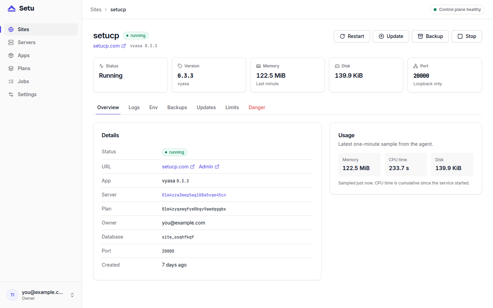
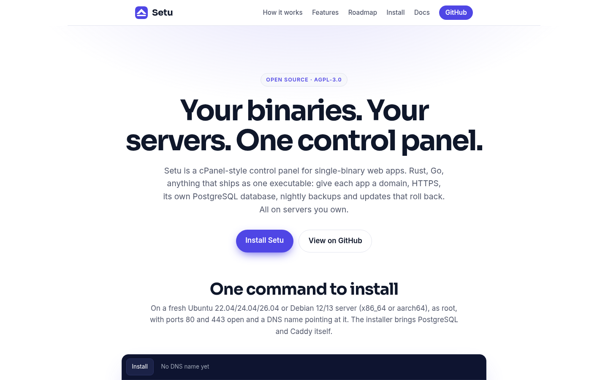

A control panel's own website should be the easiest proof that the panel works. setucp.com runs on Setu: the landing page and the docs are a Vyasa site, provisioned and kept running by a Setu panel at panel.setucp.com, on a single VPS. This post walks through the pieces, from the box to the deploy routine.

## How setucp.com runs on Setu: one box, two roles

The whole thing runs on one VPS with the standard installer. With the panel's host name, the install looks like this (the [install guide](https://setucp.com/install) has the details):

```bash
curl -fsSLO https://github.com/setucp/setu/releases/latest/download/install.sh
sudo bash install.sh --panel-host panel.setucp.com
```

That box is both the **control plane** (`setu serve`, the panel at `panel.setucp.com`) and a **managed server** (`setu agent run`). The setup wizard's last step joins the local agent, so the same machine runs the sites it manages. On such a single-box install, the panel and the agent run as the same `setu` user, which is exactly the trust trade-off the security docs describe: it is simple, and a compromise of one is a compromise of both.

On the box, the usual Setu units run side by side:

| Unit | Role |
|---|---|
| `setu.service` | the panel: API, UI, jobs, scheduler |
| `setu-agent.service` | the agent for this server |
| `caddy-api.service` | Caddy, with routes for the panel and each site |
| `postgresql.service` | the panel's database and each site's database |
| `setu-site@<short>.service` | one per site, including setucp.com |


## The site is just a Vyasa app

There is nothing special about setucp.com from Setu's point of view. It is an ordinary site of the Vyasa app, the same **New site → app → domain** flow anyone uses, so it has what Setu's Vyasa manifest gives every Vyasa site:

- its own system user and a hardened `setu-site@<short>.service`;
- its own PostgreSQL database and role;
- `media`, `index` and `registry` directories under `data/`;
- a generated `VYASA_SECRET_KEY`, and a one-time first-boot admin password that an operator can reveal from the Env tab;
- a Caddy route for the domain, with automatic HTTPS;
- a nightly backup of the database plus `media` and `registry`.

The manifest's default limits for Vyasa are 512 MB of memory and one CPU core, enforced by the site's systemd drop-in.



## The landing page is a theme, applied by API

The home page is not a set of hand-edited pages. The `setucp-site` folder holds a script, `apply.sh`, that configures a running Vyasa instance entirely through Vyasa's HTTP API, and it is idempotent: run it again to update, never to duplicate.

```bash
VYASA_URL=https://setucp.com \
VYASA_ADMIN_EMAIL=admin@example.com \
VYASA_ADMIN_PASSWORD='...' \
./apply.sh
```

In order, it logs in, uploads the icon, sets the site title, tagline and language, installs and activates a theme called `setu-landing`, writes the `/install` and `/security` pages from JSON block documents, and builds the header and footer menus. Finally it fetches `/` and checks the landing sections are there.

Two details came from Vyasa's design:

- **The home page is the theme's `index` layout.** `GET /` renders the active theme's `index` template, so the hero, install, how-it-works, features, comparison, roadmap and call-to-action sections all live in `theme/layout.json`. Activating the theme is what sets the home page.
- **Fonts are self-hosted.** Vyasa's content security policy only allows same-origin fonts, so Inter and Sora ship inside the theme.

Re-runs are cheap. The theme's package version is derived from a hash of the `theme/` folder, so an unchanged theme is not re-uploaded and an edited one installs as a new version. Older versions stay installed and can be rolled back.



## The docs come from Git

The **Docs** link in the header points at `/docs`, which the vyasa-docs plugin fills from the `docs/` folder of the Setu repository. The repository stays the source of truth; synced pages are read-only in the editor. That setup has [its own case study](post:vyasa-docs-plugin-case-study).

Two things keep it current without anyone touching the editor. A GitHub webhook on the Setu repository tells the plugin about every push to `main`, and a poll every five minutes catches anything the webhook missed. The old `docs.setucp.com` hostname is a permanent redirect to `setucp.com/docs`.

The Vyasa app itself follows its manifest URL, `https://raw.githubusercontent.com/setucp/manifests/main/vyasa/manifest.toml`, so a new Vyasa release appears in the site's **Updates** tab within six hours of the manifest being bumped. See [followed manifests](post:followed-manifests-update-notices).


## The routine

Running the site is the same routine as running any Setu site:

- **Backups.** The scheduler takes a nightly backup around 03:00 and keeps the newest seven. The panel also dumps its own database nightly. Both live on the same disk, so they need copying off the box, together with `/etc/setu/setu.toml`.
- **Vyasa updates.** A new Vyasa version shows up in the site's **Updates** tab. An update takes a `pre_update` backup first and rolls back, database included, if the new version does not come up healthy. The manifests repository has a workflow that opens a pull request whenever Vyasa releases, computing each archive's checksum itself.
- **Setu upgrades.** `setu upgrade` as root, which backs up the control plane before it swaps the binary. See [upgrading Setu itself](post:upgrading-setu-itself).
- **Content.** Pages and posts are Vyasa entries, managed through Vyasa's admin or its API like on any Vyasa site.

## What this setup proves, and what it does not

It shows the single-box path working end to end, on a real domain, every day: install, wizard, provision, TLS, backups, updates. It does not prove multi-server operation, and one box means one point of failure. That is a fair trade for a project website, and the [roadmap](post:setu-roadmap) has off-box backups and site moves in 0.2 for when it is not.

## Next steps

- Run the same setup yourself: [install Setu](https://setucp.com/install).
- Read the [operations docs](https://setucp.com/docs/operations) for backups and upgrades.
