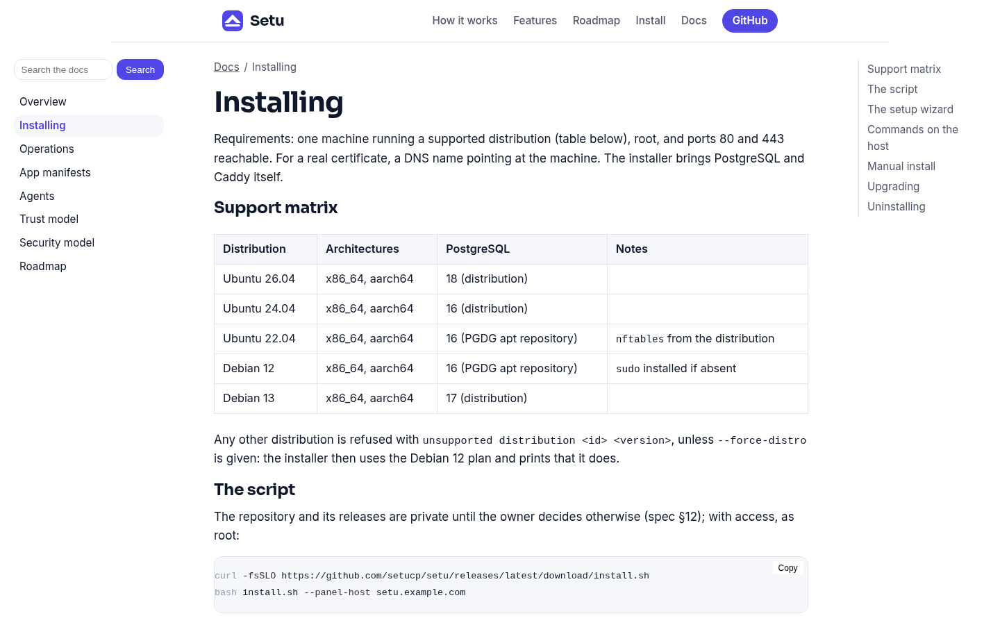
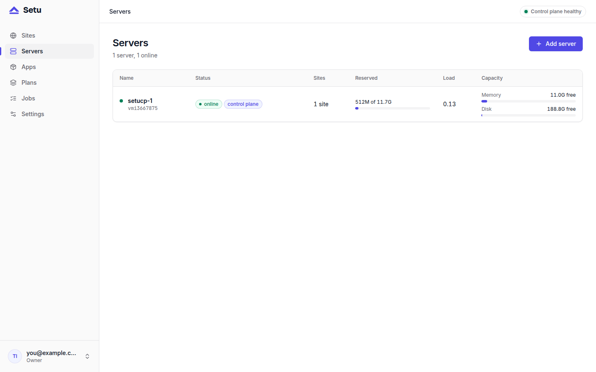

You can install Setu on a fresh VPS with one command, and have a working panel a few minutes later. This guide walks through what you need first, what the installer does, and the three wizard steps that follow, so nothing on the screen is a surprise.

## What you need before you install Setu

- A fresh server running Ubuntu 22.04, 24.04 or 26.04, or Debian 12 or 13, on x86_64 or aarch64.
- Root access.
- Ports 80 and 443 open.
- A DNS name pointing at the server, for example `panel.example.com`, if you want a real certificate.

You do not need to install PostgreSQL or Caddy. The installer brings both: PostgreSQL 16 on Ubuntu 22.04 and 24.04 and Debian 12, 17 on Debian 13, and 18 on Ubuntu 26.04. Other distributions are refused unless you pass `--force-distro`, which uses the Debian 12 plan and says so.

## Run the installer

As root, or with `sudo`:

```bash
curl -fsSLO https://github.com/setucp/setu/releases/latest/download/install.sh && sudo bash install.sh --panel-host panel.example.com
```

No DNS name yet? Use Caddy's internal certificate authority instead of ACME. Without `--panel-host`, the panel host is the machine's primary IP:

```bash
curl -fsSLO https://github.com/setucp/setu/releases/latest/download/install.sh && sudo bash install.sh --tls internal
```



The flags you are likely to use:

| Flag | Meaning |
|---|---|
| `--panel-host <dns>` | the panel's name; Caddy gets a certificate for it through ACME |
| `--tls internal` | issue from Caddy's internal CA instead of ACME |
| `--version <v>` | the release to install (default: the latest) |
| `--force-distro` | on an unsupported distribution, use the Debian 12 plan |

One of `--panel-host` and `--tls internal` is required.

## What the installer does

It is worth knowing what changes on your server. In order, the script:

1. Checks that it runs as root, on Linux, on x86_64 or aarch64, on a supported distribution.
2. Installs `sudo`, `gnupg`, `ca-certificates`, `curl`, then PostgreSQL, `zstd` and `nftables`.
3. Downloads the release archive and `SHA256SUMS`, verifies the archive, installs `/opt/setu/setu` and links it from `/usr/local/bin/setu`.
4. Creates the `setu` system user, `/var/lib/setu` and `/etc/setu`.
5. Creates the `setu` database role with a generated password, passed to `psql` on stdin, never on a command line.
6. Writes `/etc/setu/setu.toml` (mode 0600) with a unix-socket listener, the database URL, a generated `secret_key` and the panel's public URL.
7. Installs and configures Caddy with a route for the panel host.
8. Writes and starts `setu.service`, waits for `/healthz` through Caddy, and prints the setup URL and a one-time setup token.

Re-running the script is safe. An existing `setu.toml` is kept, and services restart only when the binary or the unit changed.

**Keep `/etc/setu/setu.toml` safe.** Its `secret_key` seals every site secret in the database. Without it, those values cannot be opened. Back it up with the control-plane dump, as described in [how Setu backups work](post:how-setu-backups-work).

## Finish the setup wizard

The installer ends by printing `https://panel.example.com/setup` and a setup token. Then:

1. **Open the URL and paste the token.** The token is read from `/var/lib/setu/setup-token`, and it is removed once the owner exists.
2. **Create the owner account.** This works exactly once. After that, `/setup` answers 409.
3. **Register this server.** The wizard shows a `setu agent install` line and, separately, a join token. Run the line as root with the token in `SETU_JOIN_TOKEN`:

```bash
SETU_JOIN_TOKEN=<token> setu agent install --control-plane https://panel.example.com --panel-host panel.example.com
```

The join token is never accepted on the command line, where `ps` and shell history would show it; it comes from the environment or stdin. The server shows `online` within seconds.



If you used `--tls internal`, browsers need Caddy's root certificate, found at `/var/lib/caddy/.local/share/caddy/pki/authorities/local/root.crt`.

## Check that everything is healthy

On the server, the agent can check its own setup:

```bash
setu agent doctor
```

It prints one row per check, covering the helper binary, the sudoers file, the site template unit, Caddy's admin socket, the firewall table, Postgres and the control plane's `/healthz`, and exits 1 if anything fails. Logs are in the journal:

```bash
journalctl -u setu
journalctl -u setu-agent
journalctl -u caddy-api
```

## Next steps

The panel is up, with no apps yet. Add one and create a site: [your first Vyasa site on Setu](post:first-vyasa-site-on-setu) walks through it. For domains and certificates beyond the panel host, see [custom domains and automatic HTTPS with Caddy](post:custom-domains-automatic-https-caddy). Later, `setu upgrade` keeps the install current. The full reference, including the manual install, is at [setucp.com/docs/install](https://setucp.com/docs/install).
