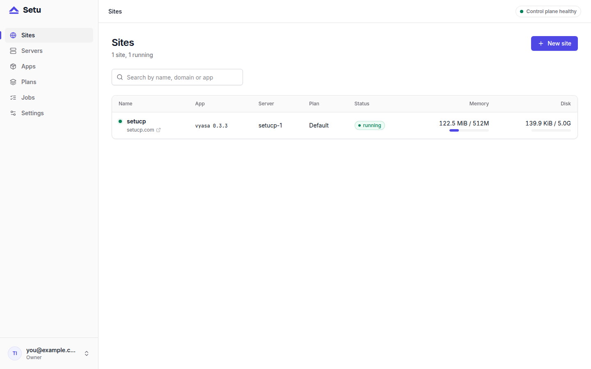

A small VPS with a few gigabytes of memory is enough for a lot of compiled web apps, but only if each one stays in its lane. Running many sites on one VPS goes wrong in familiar ways: one process eats all the memory, two apps fight over a port, every backup starts at the same minute. This post shows how Setu handles each of those on a single box, and where its limits are.

## One unit, one user, one port per site

Every site is a systemd instance, `setu-site@<short>.service`, where `<short>` is an eight-character id. Each runs as its own system user, `setu-site-<short>`, with a uid between 30000 and 39999 and no login shell. The app can write only its own `data/` and `run/` directories under `/srv/setu/sites/<short>/`; the binary in `bin/` is root-owned.

Each site also gets a port from 20000 to 29999, unique per server, allocated when the site is created. Apps bind `127.0.0.1:<port>`, and an nftables table, `inet setu`, drops non-loopback TCP to that whole range, so the only way in is through Caddy on 443. Before starting, provisioning checks that nothing else on the host already listens on the chosen port.



## Memory and CPU limits that the kernel enforces

Limits live in a per-site drop-in rendered from a fixed template:

```ini
[Service]
ExecStart=
ExecStart=/srv/setu/sites/{short}/bin/current/{exec} {args}
WorkingDirectory={workdir}
MemoryMax={memory_mb}M
CPUQuota={cpu_percent}%
```

`MemoryMax=` and `CPUQuota=` are cgroup limits, so an app that leaks memory is stopped at its ceiling instead of pushing the box into swap. `cpu_percent = 100` means one core.

The numbers come from a **plan**. Setu seeds one called Default: 512 MB, 100 % CPU, 5 GB disk. Each manifest also carries its own defaults in `[limits.default]`; the plan's limits override them. Vyasa's manifest asks for 512 MB, and the Miniflux manifest asks for 256 MB. Changing a site's plan is a drop-in rewrite plus a restart. Limits get their own post, [Resource limits: memory and CPU per site](post:site-limits-memory-cpu).

## How Setu decides the box is full

Capacity is checked once, when you create the site, inside the same transaction that allocates its port, database and secrets. The rule from the design spec is:

- the plan memory of every other site on the server, whatever its status,
- plus this site's plan memory,
- plus 256 MB for Postgres and Caddy,
- plus 512 MB when the server also hosts the control plane,

must be at most 85 % of the server's memory. A server whose memory is unknown is refused. When you let Setu pick the server, it ranks online, uncordoned servers by memory left.

This is a reservation model, not a measurement. Setu counts what each plan allows, not what the app happens to use today, so a box never gets oversubscribed on paper. If your sites use far less than their plans, a smaller plan is how you fit more of them.

## Keeping background work from piling up

A box with many sites also has many backups, installs and restarts. Setu spreads them out:

- **Backups.** The scheduler enqueues one nightly backup per running site at 03:00 in the control plane's time zone, offset per site by up to ±20 minutes, so the sites on one server do not all dump at once.
- **Installs.** At most two installs run per server at once.
- **Commands.** The agent runs commands concurrently, but each site has its own FIFO queue, so one site's long install never blocks another site.
- **Disk measurement.** Heartbeats read memory and CPU every 15 seconds, but walk each site's data directory with `du` at most every ten minutes.

## What many sites on one VPS still share

Process isolation is not VM isolation, and Setu says so plainly. Sites on one server share:

- **the kernel**: a kernel exploit in one site affects every site;
- **the Postgres instance**: each site has its own role and database with `CONNECT` revoked from `PUBLIC`, but one busy site can load the shared server;
- **loopback**: a site can reach another site's port on 127.0.0.1, and can send forged `X-Forwarded-For` headers to apps that trust 127.0.0.1 as a proxy;
- **disk**: `disk_mb` is reported, not enforced, in this release.

The practical rule from the security docs: host mutually distrusting customers on separate servers. Many sites on one VPS is a good fit for your own projects, or for sites that trust each other.

## When one box is not enough

Setu's agent runs on any number of servers. **Servers → Add server** shows an install command and a one-time join token; run it as root on the new machine:

```bash
SETU_JOIN_TOKEN=setu_join_… setu agent install --control-plane https://setu.example.com
```

The server shows `online` within seconds. **Cordon** an existing server to stop new sites landing on it; its current sites keep running. Moving sites between servers is on the roadmap for 0.2, not in the current release.

## Next steps

Read [Monitoring a small VPS without a monitoring stack](post:monitoring-a-small-vps) to keep an eye on the box once it is full, and the [operations guide](https://setucp.com/docs/operations) for backups and day-two tasks. To try it, start at [setucp.com/install](https://setucp.com/install).
