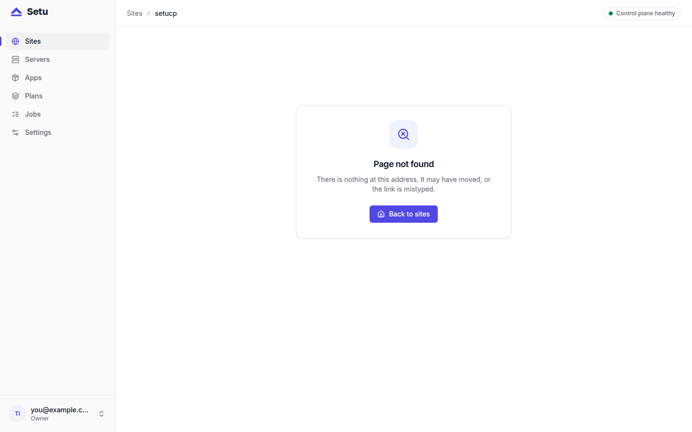

Sooner or later you will need to restore a site backup: a bad import, a plugin that mangled content, a deleted page someone needed. In Setu that is one action in the panel, and it is built so that the restore itself can be undone. This guide covers the panel restore, what each step does, and the manual procedure for a site that no longer exists.

If you have not read it yet, [how Setu backups work](post:how-setu-backups-work) explains what a backup contains and where it lives.

## Before you restore

Three things are worth knowing first.

- **A restore replaces the database and the backed-up directories.** Anything written to them since the backup was taken is replaced. Directories the manifest does not back up, such as Vyasa's rebuildable `index`, are not part of it.
- **The site is stopped during the restore.** Plan for a short outage.
- **You can only restore a site's own backups from the panel.** The backup must be a completed backup of the same, still existing site.

## Restore a site backup from the panel

Open the site, go to the **Backups** tab, and choose **Restore** on the backup you want.


Setu runs a restore job. You can follow it on the Jobs page, and its steps are:

1. **validate**: the backup is a completed backup of this site.
2. **backup**: take a `pre_restore` backup of the site as it is now.
3. **stop**: stop the site's service.
4. **restore**: replace the database and swap in the backed-up directories.
5. **start**: start the site again.
6. **health**: wait for the app's health path to answer.
7. **finish**.



### What happens underneath

The restore step does two things. For the database, it drops it, recreates it and runs `pg_restore` from `db.dump`. For the directories, the root helper unpacks `dirs.tar.zst` into a root-owned staging directory, hands the files to the site's user and swaps them into `data/`. The site's unit must be inactive while this happens, which is why the job stops it first.

The archive is checked on the way in. Any entry with `..`, an absolute name, a symlink, a hard link, a device file or a setuid, setgid or sticky bit makes the whole operation fail, leaving nothing behind.

### If something goes wrong

The restore is designed to fail safe at each point:

- If the `pre_restore` backup fails, or the site will not stop, the restore ends and the site stays running as it was.
- If the directory swap fails, the old data is put back.
- If a backup's `dirs.tar.zst` is missing, the restore fails rather than restoring only half the site.

And because step 2 took a `pre_restore` copy, a restore that worked but brought back the wrong state can itself be reversed: restore the `pre_restore` backup the same way. It is kept for 30 days.

## Restoring a site that was deleted

Deleting a site takes a `pre_delete` backup, kept for 30 days. Those backups stay listed on the top-level **Backups** page, with the old site's name and domain, but the panel cannot restore them, because the site they belong to is gone. Bringing one back is manual.

First, create a new site of the same app from the panel. Note its short id (`NEW` below) and the old one (`OLD`). Then, on the server, as root:

```bash
systemctl stop setu-site@NEW
sudo -u postgres pg_restore --clean --if-exists --no-owner --role=site_NEW -d site_NEW \
  < /var/lib/setu/backups/OLD/<backup_id>/db.dump
zstd -dc /var/lib/setu/backups/OLD/<backup_id>/dirs.tar.zst | tar -x -C /srv/setu/sites/NEW/data
chown -R setu-site-NEW:setu-site-NEW /srv/setu/sites/NEW/data
systemctl start setu-site@NEW
```

One catch: the new site has its own generated secrets. For Vyasa that means a new `VYASA_SECRET_KEY`. Data the app encrypted under the old site's key will not open with the new one, and the deleted site's env is gone with its row. Your posts and media come back; anything the app sealed with its own key may not.

## Restoring when the server itself is gone

Site backups live on the server, so if you lose the server you can recover only from copies you made off it. The operations docs describe rebuilding a server from those copies: reinstall, restore `/var/lib/setu/backups/`, re-join the agent to the old server's record, re-run provisioning for each site and restore its newest backup from the Backups tab. That procedure is not covered by the automated tests, so practise it before you need it.

The control plane has its own restore: stop `setu`, put back the saved `setu.toml`, recreate the `setu` database and `pg_restore` the dump. The exact commands are in [setucp.com/docs/operations](https://setucp.com/docs/operations).

## Practise once

A restore you have never tried is a guess. On a test site, write something, take a manual backup with **Back up now**, change it, and restore. It takes a few minutes and tells you exactly how long your sites are down during a restore.

## Next steps

Updates use the same machinery: every update takes a `pre_update` backup, and a failed one restores it for you. Read [safe app updates: backup first, every time](post:safe-updates-backup-first). For public demos that should reset on a schedule, the Backups tab also offers **Use as reset point**, which restores a chosen backup on a schedule, from every 15 minutes up to weekly, without taking a safety copy.
