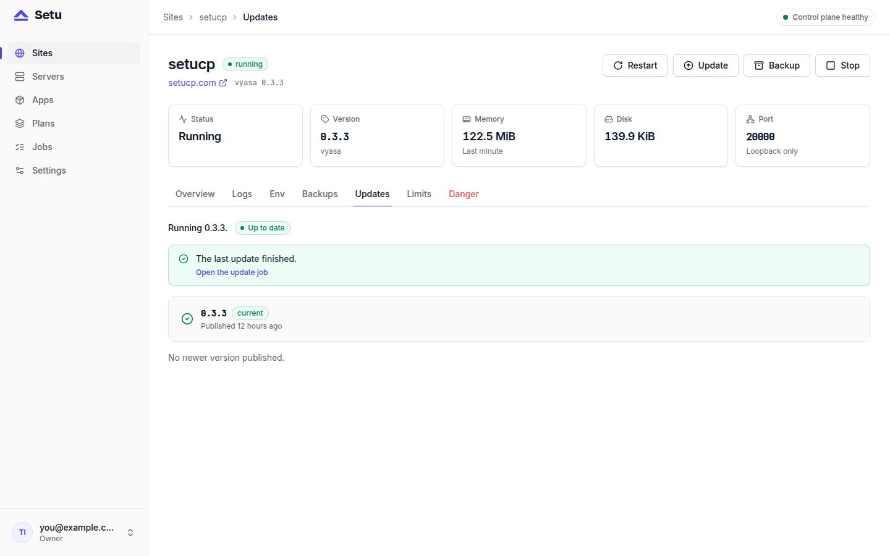

Updating a self-hosted app is where most outages begin: a migration that fails halfway, a new version that will not start, a config change nobody noticed. Setu runs site updates with rollback built in. It takes a backup before anything changes, and if the new version does not come up healthy, it puts the old one back, restoring the database too when it has to.

This post walks through what happens when you click Update, and why each step is there.

## Where updates come from

Each app version is a manifest. When a new version is published, it appears in the **Updates** tab of every site running that app.

Since Setu 0.1.5, you rarely publish by hand. An app added from a manifest URL follows it: Setu fetches the URL every 6 hours and publishes any new version. **Check now** on the Apps page checks at once. Two limits keep this safe:

- **Sites are never updated on their own.** A new version only appears in the Updates tab. You decide when each site moves.
- **A check never replaces a published version.** If the manifest at the URL changes for a version Setu already has, the check leaves it alone. A manifest names binaries and checksums, and an unattended re-publish must not swap what a running version installs.

More on following manifests in [followed manifests: updates that find you](post:followed-manifests-update-notices).

## The update job, step by step

When you choose a version and confirm, Setu runs an update job with these steps:

1. **validate**: the version exists for this app and is a binary release.
2. **env**: work out the new environment from the new manifest.
3. **backup**: take a `pre_update` backup of the database and data directories.
4. **install**: download the new binary, verify its checksum, unpack it next to the old one.
5. **stop** the site.
6. **switch_version**: point `bin/current` at the new version.
7. **write_unit** and 8. **write_env**.
9. **start** the site.
10. **health**: wait for the health path to answer `2xx`.
11. **finish**: record the new version.

The order matters. Everything that can fail without touching the running site (validation, the backup, the download and checksum check) happens while the old version is still serving. A bad checksum or a hostile archive fails at step 4, and the running site is untouched.

## How the environment carries over

An update keeps what must not change. Values the manifest generates, such as `VYASA_SECRET_KEY`, and answers to prompts are kept by name. Values from `from` and `value` rules are worked out again, and the database URL keeps its password. New rules in the new version are resolved fresh: if the new version adds a prompt, the update dialog asks you for it in a labelled field. Rules the new version removed are dropped. A one-time value, like the first admin password, is never written again.

## How updates with rollback handle a failed version

The interesting part is what happens on failure. Setu's rules depend on how far the update got:

| Fails at | What Setu does |
|---|---|
| before `stop` | puts the old env back; the site keeps running the old version |
| `stop`, `switch_version`, `write_unit` or `write_env` | rolls back to the old binary, unit and env, **without** a restore: the new version never ran |
| `start` or `health` | rolls back **and** restores the `pre_update` backup: the new version may already have migrated the database |

The rollback stops the site, switches back to the old version, writes the old unit and env, restores when needed, starts it and waits for health again.

When the rollback works, the site ends up `running` on the old version with its old env, and the job is marked `failed` with an error starting `rollback:`. That is deliberate: the site is fine, and the update did not happen. If the rollback itself fails, the site is marked `failed` with `failed_step = rollback`, so it is never shown as healthy when it is not.

Setu's end-to-end test checks the hardest case for every release. It updates a test app to a version that migrates its database and then fails its health check, and asserts that the site is back on the previous version, the new table is gone, the old one is present, and the data is intact.

## Why health checks decide

Everything above rests on one signal: the app's health path. After a start, Setu polls `127.0.0.1:<port><health>` every 500 ms until it answers `2xx` or the manifest's `startup_grace_s` runs out (90 seconds by default). For Vyasa, the path is `/readyz`.

So an app should answer `2xx` only when it can really serve, with migrations done and first-boot work finished. A health path that always returns 200 turns rollback into a formality.

## A routine for updating

1. Read the app's release notes.
2. Update one site first, ideally a staging copy, and watch the job on the Jobs page.
3. Check the site yourself after the job finishes.
4. Update the rest.

The `pre_update` backup is kept for 30 days. If you find a problem later than the health check could, restore it from the Backups tab.

## Next steps

Setu itself is upgraded separately, with `setu upgrade`, which also backs up the control plane first; see [upgrading Setu itself](post:upgrading-setu-itself). For what is inside the `pre_update` copy, read [how Setu backups work](post:how-setu-backups-work). The manifest's `health` and `startup_grace_s` fields are described at [setucp.com/docs/manifest](https://setucp.com/docs/manifest).
