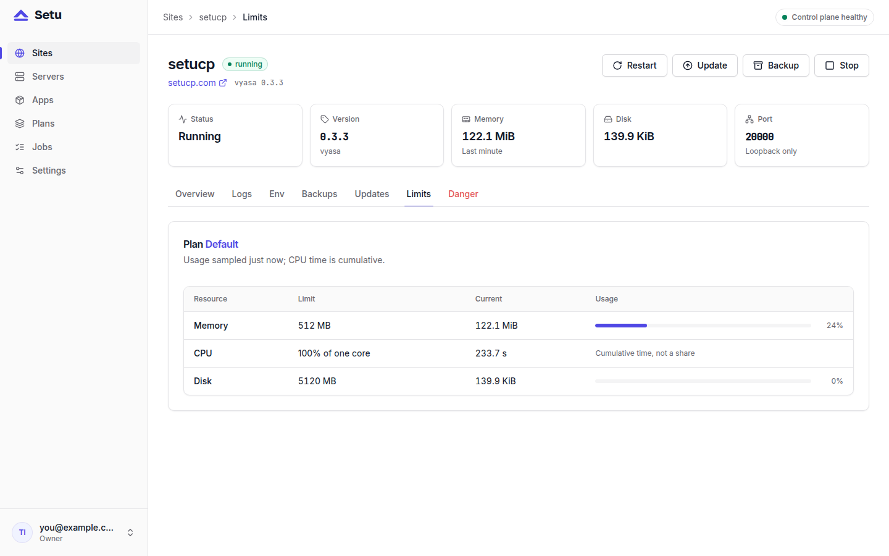

When several sites share one server, one runaway process can starve the rest. Setu gives every site memory and CPU limits that the kernel enforces, so a leak or a busy loop stays inside that site's own budget. This post covers where those limits come from, how they reach systemd, and how to check them yourself.

## Where memory and CPU limits come from

There are two sources, and one overrides the other.

The app's manifest carries a `[limits.default]` table. The Vyasa manifest, for example, says:

```toml
[limits.default]
memory_mb = 512
cpu_percent = 100
disk_mb = 5120
```

The sample `hello-axum` manifest asks for less (`memory_mb = 128`, `cpu_percent = 50`, `disk_mb = 512`), and Miniflux sits in between at 256 MB. These are the app author's suggestion.

The **plan** is what the operator decides. A plan has a name, `memory_mb`, `cpu_percent`, `disk_mb` and an optional list of allowed app ids. Per the manifest reference, the plan's limits override the manifest defaults. Setu seeds one plan, "Default", at 512 MB, 100 % and 5 GB. You pick a plan in the New-site flow, which runs app, version, plan, then domain.

`cpu_percent` is measured against one core: `100` is one full core, `50` is half a core, and `200` would be two.

### Creating a plan

Plans live under **Plans** in the panel. Only the `owner` role can create or edit them; operators and viewers can list them. The API is the same thing in JSON:

```bash
curl -X POST https://panel.example.com/api/v1/plans \
  -H 'Content-Type: application/json' \
  -H 'Origin: https://panel.example.com' \
  --cookie 'setu_session=…' \
  -d '{"name": "Small", "limits": {"memory_mb": 256, "cpu_percent": 50, "disk_mb": 2048}, "allowed_app_ids": ["miniflux", "vyasa"]}'
```

The `Origin` header is not optional: every mutation under `/api/v1` must carry an `Origin` equal to the panel's URL (or `Sec-Fetch-Site: same-origin`), or it is refused with 403. Leave `allowed_app_ids` as `null` to allow every app.

## How the limits reach systemd

Each site runs as `setu-site@<short>.service`, where `<short>` is the site's eight-character id. The template unit holds the hardening (`ProtectSystem=strict`, `NoNewPrivileges=yes`, `PrivateTmp=yes` and more). A per-site drop-in holds what differs between sites, written by the privileged helper's `write-unit` verb from a fixed template:

```ini
[Service]
ExecStart=
ExecStart=/srv/setu/sites/{short}/bin/current/{exec} {args}
WorkingDirectory={workdir}
MemoryMax={memory_mb}M
CPUQuota={cpu_percent}%
```

So a 512 MB plan becomes `MemoryMax=512M` and a 100 % plan becomes `CPUQuota=100%`. The kernel's cgroup controller does the enforcing; Setu runs no watchdog of its own.

You can read the result back on the server:

```bash
systemctl cat setu-site@<short>
systemctl show setu-site@<short> -p MemoryMax -p CPUQuotaPerSecUSec
```

Setu's end-to-end test checks exactly this: after provisioning a site on the 512 MB default, `MemoryMax` must read `536870912` bytes.

## What happens when a site hits a limit

The two limits behave differently, because that is how cgroups work.

- **CPU** is a quota. A site that wants more than its share is throttled: it runs slower, but it keeps running, and its neighbours keep their share.
- **Memory** is a ceiling. When a site's processes reach `MemoryMax`, the kernel first tries to reclaim memory inside that cgroup, and if it cannot, the out-of-memory killer acts inside that site only. The template unit has `Restart=on-failure` with `RestartSec=2`, so systemd starts the site again.

If a site keeps getting killed, the journal will say so. `journalctl -u 'setu-site@<short>'` (also the site's **Logs** tab) is the first place to look, and raising the limit is a plan decision rather than a fix in the app.

## Capacity: admitted once, at creation

Limits also decide whether a site fits on a server at all. When you create a site, Setu locks the server row and adds up:

1. the plan memory of every other site on that server, in any status;
2. this site's plan memory;
3. 256 MB for Postgres and Caddy;
4. 512 MB more when the server is also the control plane.

The total must stay at or below 85 % of the server's memory, or the site is refused. A server whose memory is unknown is refused too. When Setu picks the server itself, it ranks online, uncordoned servers by memory left. This check runs once, at `POST /sites`, inside the same transaction that allocates the port, database and secrets, so two concurrent creates cannot both squeeze into the last slot.

This is a reservation model: it counts the plan, not what the site happens to use today. For more on packing sites onto a small box, see [running many sites on one small VPS](post:many-sites-one-small-vps).



## Reading usage, and the truth about disk

The agent's heartbeat runs every 15 seconds and reads each site's memory and CPU from systemd every beat. The size of a site's data directory (`du -sb data/`) is measured at most every ten minutes, because walking a large media folder is not free. The sites list and the **Limits** tab show memory and disk as `used / limit` with bars. CPU is reported as cumulative CPU time, which is not a ratio of the quota, so read it as a trend.

Disk needs a plain warning: in 0.1.x, `disk_mb` is **reported, not enforced**. A site can write past its disk number and nothing stops it except the filesystem filling up. Enforced quotas (XFS project quotas where available) are on the roadmap for 0.2. Until then, watch disk on the server; [monitoring a small VPS](post:monitoring-a-small-vps) covers a low-effort way to do that.

## Changing a site's limits later

In 0.1.x a site keeps the plan it was created with: the API has no route for moving an existing site to another plan. The roadmap describes plan changes as a drop-in rewrite plus a restart, which is how the unit layout above was designed to work. If a site needs a different budget today, the path is a new site on the right plan and a manual restore of the old site's backup into it, as described in [restoring a backup](post:restoring-a-backup). Mind the catch the operations docs spell out: the new site gets its own generated secrets, so data an app encrypted under the old site's key does not open with the new one. Choose plans with some headroom from the start.

## Next steps

- Read the manifest fields for `[limits.default]` in the [manifest reference](https://setucp.com/docs/manifest).
- See the unit hardening and what sites share in the [security docs](https://setucp.com/docs/security).
- New to Setu? Start with the [install guide](https://setucp.com/install).
