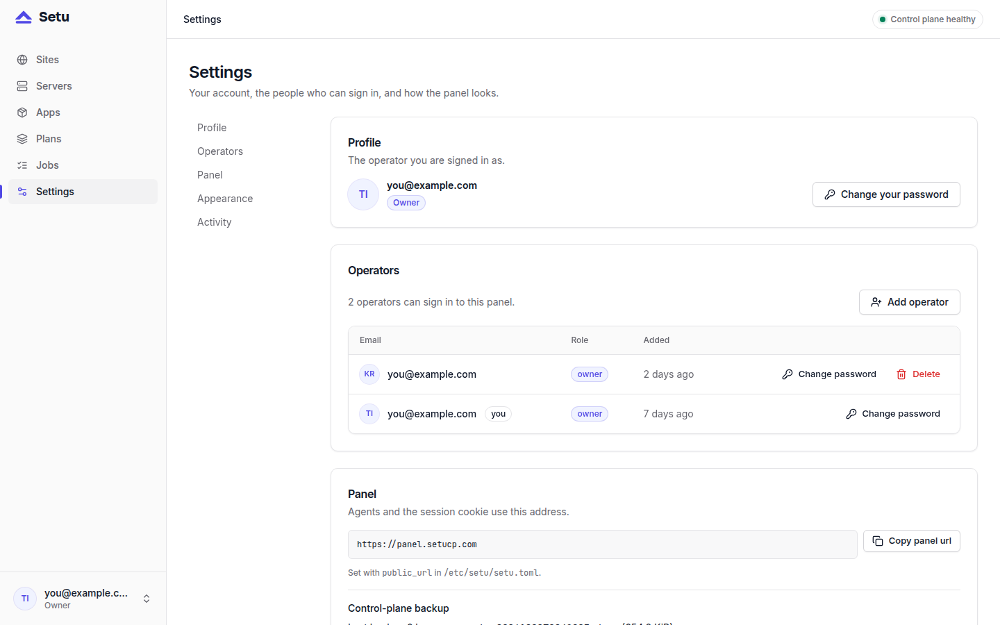

A control panel that is hard to upgrade stays on old versions, and old versions are where known bugs live. Before 0.1.5, upgrading Setu meant re-running `install.sh` with the exact flags of the first install. Now there is `setu upgrade`, one command that verifies the release, backs up the control plane and swaps the binary.

This post is about Setu itself. Updating the apps your sites run (Vyasa, Miniflux and so on) is a separate, per-site action in the panel, covered in [safe updates, backup first](post:safe-updates-backup-first).

## What setu upgrade does

Run it as root on any Setu server:

```bash
setu upgrade                    # the latest release
setu upgrade --version 0.1.5    # a given release
```

In order, it:

1. **Resolves the version.** `--version` if given, otherwise the latest release of `setucp/setu`. If the server is already on it, it says so and exits 0.
2. **Downloads and verifies.** It fetches `setu-<ver>-<target>.tar.gz` for this machine's architecture and the release's `SHA256SUMS`, refuses an archive whose checksum does not match, extracts it, and checks that the new binary reports the version that was asked for.
3. **Backs up the control plane**, on the box where `setu.service` is enabled. The dump goes into `/var/lib/setu/backups/setu/`, the same directory and rotation as the nightly self-backup. If the backup fails, the upgrade stops there.
4. **Installs the binary** at `/opt/setu/setu`, writing it next to the old one and renaming it into place.
5. **Restarts** `setu.service` (migrations run on boot) and, when it is enabled, `setu-agent.service`.
6. **Waits for health.** On the control plane it waits up to 90 seconds for `/healthz` and fails loudly if it never answers.

Two details make this safer than it looks. The checksum step means a truncated or tampered download never reaches `/opt/setu`. And because the backup comes before the binary swap, there is always a fresh dump of the panel's database from just before the new migrations ran.

### Why downgrades are refused

`setu upgrade` refuses to move to an older release unless you pass `--allow-downgrade`. The reason is migrations: Setu's database migrations are forward-only. 0.1.4 added `0003_site_resets.sql` and 0.1.5 added `0004_app_sources.sql`, and an older binary does not know what to do with tables a newer one created.

If an upgrade goes wrong, the way back is not a downgrade on top of a migrated database. It is restoring the control-plane dump that the upgrade just took, then installing the old binary. The procedure for restoring the control plane is in the [operations docs](https://setucp.com/docs/operations).

## The order: control plane first

Setu has two kinds of box: the control plane (`setu serve`, the panel) and managed servers (`setu agent run`). On a single-box install they are the same machine. With several servers, the rule from the docs is simple: **upgrade the control plane first, then the other servers.**

On each other server, run the same `setu upgrade` as root. There it skips the control-plane backup and the health wait, installs the binary and restarts the agent. The panel does not upgrade other servers for you in 0.1.x; that is listed as out of scope for 0.1.5, and agent self-update from the control plane is on the 0.2 roadmap.

## Before you run it

The upgrade takes its own backup, but that copy sits on the same disk as the panel. Two things are worth doing first:

- **Copy a control-plane dump and `setu.toml` off the box.** Every site secret in the database is sealed with `secret_key` from `/etc/setu/setu.toml`. A dump without that file cannot open those secrets. Store `setu.toml` like a private key.
- **Read the changelog section** for the version you are moving to. It names any new migration and any behaviour change.

A manual dump is one command, and since 0.1.5 it works from any directory, because `setu` falls back to `/etc/setu/setu.toml` when the current directory has none:

```bash
sudo -u setu setu backup --out /var/lib/setu/setu-$(date +%F).dump
```

Then copy that file and `/etc/setu/setu.toml` to another machine.

## Upgrading from a version before 0.1.5

`setu upgrade` is itself a 0.1.5 feature, so a server on 0.1.4 or older does not have it yet. For that one hop, re-run the installer with the original flags and the new version:

```bash
curl -fsSLO https://github.com/setucp/setu/releases/latest/download/install.sh
sudo bash install.sh --panel-host panel.example.com --version 0.1.5
```

The installer verifies the archive against `SHA256SUMS`, keeps your existing `setu.toml`, and restarts `setu` and the local agent only when the binary changed. It does not take the control-plane backup, so run `setu backup` yourself first. From then on, `setu upgrade` is available.

## Checking the result

After the upgrade, a few checks tell you everything is back:

```bash
systemctl status setu setu-agent
journalctl -u setu -n 50
setu agent doctor
```

`setu agent doctor` prints one row per check (helper permissions, sudoers, Caddy's admin socket, the firewall table, Postgres, the server token, the control plane's `/healthz`) and exits 1 on any failure. In the panel, **Servers** should show each server `online` again within seconds, and **Settings → Panel** shows the last successful control-plane backup, which should now be the one the upgrade took.



## What does not change

An upgrade of Setu does not touch your sites. Their binaries, env files and databases stay as they are; they keep running under their own systemd units while `setu` and `setu-agent` restart. App versions move only when you press **Update** on a site, and even an app that [follows its manifest URL](post:followed-manifests-update-notices) only gets new versions offered, never installed on its own.

## Next steps

- Read the release checks behind `SHA256SUMS` in [checksums and signed releases](post:checksums-and-signed-releases).
- Keep the [operations docs](https://setucp.com/docs/operations) open for the control-plane restore procedure.
- Fresh server? The [install guide](https://setucp.com/install) gets you to a panel first.
