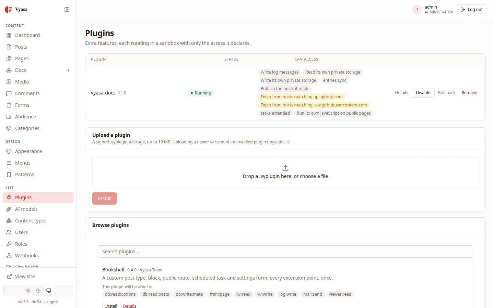

Documentation drifts when it lives in two places, so the Setu docs are Markdown files next to the code, reviewed in the same pull requests. The question was how to publish that folder as a proper Markdown docs site on setucp.com without copying files by hand. The answer is a Vyasa plugin, vyasa-docs, and this post shows how it is set up.

## The source of the Markdown docs site: one folder

Everything under `setucp.com/docs` comes from the `docs/` folder of the Setu repository on GitHub. The files are the same ones a reader sees on GitHub: `INSTALL.md`, `OPERATIONS.md`, `MANIFEST.md`, `AGENT.md`, `TRUST.md`, `SECURITY.md`, `ROADMAP.md` and the `README.md` that introduces them.

Nothing in those files is written for the website. They use relative links between each other and ordinary CommonMark with tables, which both GitHub and the plugin render.

The folder also has things that should not be on a public docs site: the end-to-end test notes, the release procedure, design specs and brand assets. A small `_meta.json` file decides that:

```json
{
  "README": "Overview",
  "INSTALL": "Installing",
  "OPERATIONS": "Operations",
  "MANIFEST": "App manifests",
  "AGENT": "Agents",
  "TRUST": "Trust model",
  "SECURITY": "Security model",
  "ROADMAP": "Roadmap",
  "E2E": {"title": "End-to-end test", "hidden": true},
  "RELEASING": {"title": "Releasing", "hidden": true},
  "specs": {"title": "Design specs", "hidden": true},
  "brand": {"title": "Brand", "hidden": true}
}
```

Names listed in `_meta.json` come first in the sidebar, in that order, with those titles. Entries marked `hidden` stay out of the navigation. Everything not listed falls back to a `position` in front matter, or a numeric file prefix such as `02-`, then to alphabetical order.

## The plugin: vyasa-docs

vyasa-docs (0.1.3) is a Vyasa plugin. You point it at a folder of Markdown in a GitHub repository, and it keeps a **Docs** section of the site in step with it: a sidebar that follows the folder structure, a table of contents, previous and next links, breadcrumbs, versions, and search scoped to the docs. It needs Vyasa 0.3 or newer.

Each page becomes an ordinary Vyasa entry of the `doc` content type, served at `/docs/<path>`. Those entries are read-only in the editor, with a note "Synced from vyasa-docs. Edit it at the source." and an **Edit source** link. The rule is clear: the repository is the source of truth. If someone wants to take a page over in the CMS, **Detach** makes it an ordinary page, and the importer never touches it again.


### What it is allowed to do

Vyasa plugins are WebAssembly components that get only the capabilities they declare. vyasa-docs asks for these, and nothing else:

- `log:write`, plus `kv:read` and `kv:write` for its own state;
- `entries:sync` and `db:publish:posts`, to write and publish the pages;
- `net:fetch:api.github.com` and `net:fetch:raw.githubusercontent.com`, to read the repository;
- `tasks:extended`, because a sync can run for up to a minute;
- `assets:script`, for a small script that powers tabs, copy buttons and the contents highlight. Pages read correctly without it.

For a plugin that pulls content from the internet into your site, that list is reassuring: it can reach two GitHub hosts and its own data, and that is all.

## The settings

The plugin's settings page holds the whole configuration:

| Setting | What it does |
|---|---|
| Repository | `https://github.com/owner/name` |
| Branch | default `main` |
| Folder | default `docs`; empty means the repository root |
| Token | fine-grained, Contents: read; for private repos or higher rate limits. Write-only |
| Webhook secret | shared with the GitHub webhook. Write-only |
| Check every (minutes) | 5 to 1440, default 60 |
| Latest version, Older versions | for versioned docs |

For a layout like Setu's, the defaults fit as they are: branch `main`, folder `docs`.

## Keeping it current: webhook plus polling

Polling alone would mean waiting up to an hour after a merge. The plugin also accepts a GitHub webhook:

- Payload URL: `https://<your-site>/api/v1/plugin/vyasa-docs/webhook`
- Content type: `application/json`
- Secret: the same value as the plugin's webhook secret
- Events: just the push event

A delivery without a valid signature gets `401` and does nothing. A push to the configured branch queues a sync that runs within the minute. Polling stays on as a safety net, so a missed delivery is caught on the next run. A sync that cannot finish in one minute pauses and continues on the next run.

When something does go wrong, the **Plugins** page shows the `sync` task's last status and error. A `404` means the repository, branch or folder is wrong; `403` is GitHub's rate limit (add a token); `401` is a bad or expired token.



## Versions, when the docs need them

Setu's docs have a single version today: `/docs` describes the current release. The plugin supports two ways to keep old docs online once that changes. One is a folder per version: set *Latest version* to `v3`, keep current docs in `docs/`, and list `v2 = docs-v2` under *Older versions*. Old pages then get a banner that links to the current page, which they also name as canonical. The other is a `version:` key in a page's front matter.

### Limits worth knowing

512 KiB per page, 2000 pages, nesting up to 8 levels, 12 versions. Images show only from public repositories. Footnotes and math are left as literal text, which matters if you write documentation in that style.

## Why this setup works

The docs are reviewed with the code, rendered on GitHub for people reading the repository, and published on the website without a separate build pipeline or a copy step. The website itself is a Vyasa site running on a Setu panel, which [how setucp.com runs on Setu](post:how-setucp-com-runs-on-setu) describes.

## Next steps

- Read the result: start at the [docs overview](https://setucp.com/docs/overview).
- Get the server side running with the [install guide](https://setucp.com/install).
- Put Vyasa on it with [your first Vyasa site on Setu](post:first-vyasa-site-on-setu).
